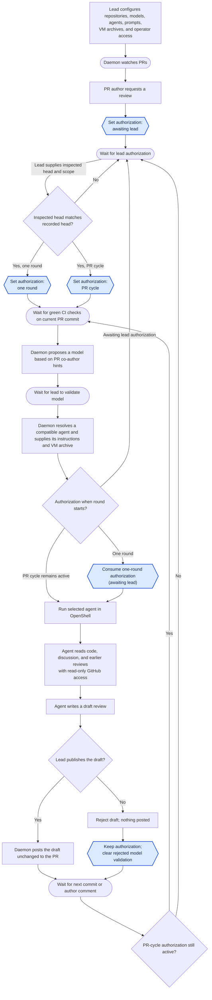

# Architecture

This document is for contributors.
End-user installation and workflow documentation lives in [README.md](README.md).

## System overview

- **GitHub**: PR authors request reviews in the PR.
  GitHub supplies commits, model co-author hints, author comments, check results, and earlier reviews,
  and displays reviews the lead has chosen to publish.
- **Daemon**: Holds repository settings, the VM archive and checksum for each repository and agent pair,
  and each PR’s authorization state: awaiting authorization, authorized for one round, or authorized for the PR cycle.
  It manages agents' review instructions (prompts), proposes a model different from the PR's co-author model when possible,
  resolves the first compatible configured agent, and supplies that agent's instructions and verified archive for each round.
  It connects to the configured OpenShell gateway and manages only the sandboxes it creates for review rounds.

  It waits for green checks, starts review rounds after lead validation, tracks progress, holds draft reviews,
  and posts only drafts the lead has chosen to publish.
  After a rejection, it waits for valid model validation and active authorization
  before starting another round.
- **Operator interface**: Shows the lead pending requests and draft reviews.
  It lets the lead edit agent prompts, authorize one round or the full cycle, change that choice,
  publish or reject drafts, validate or change the daemon's proposed model,
  and monitor reviews.
  It may be a CLI, terminal UI, or graphical UI.
- **OpenShell gateway**: Runs independently of Review Platform.
  Its operator manages gateway access, provider profiles, provider credentials, and rotation.
- **OpenShell sandbox**: Runs a selected agent, such as Claude or Codex, from the VM archive configured for that repository and agent,
  with instructions and named providers selected by the daemon.
  The agent has read-only GitHub access and returns draft text to the daemon;
  the daemon holds the publishing authority.

## Authorization states

Each requested PR has one authorization state.
Authorization controls whether a new review round may start;
it does not describe whether CI is pending, an agent is running, or a draft awaits the lead's decision.
Every round also requires green CI checks for the current PR head and lead validation of the model.

The state file stores the three values as `awaiting_lead`, `one_round`, and `pr_cycle`.
Entering either authorized state requires the head SHA and input revision the lead inspected
to match the locally recorded values.

| State | What it allows | How it changes |
| --- | --- | --- |
| **Awaiting lead authorization** | No new round may start. | A new request starts here; the lead can authorize one round or the PR cycle. |
| **Authorized for one round** | One round may start for the current PR head and author discussion. | The authorization is consumed when the round starts. A new commit or author comment before then clears it. The lead can also switch or revoke it. |
| **Authorized for the PR cycle** | The current round and later rounds triggered by new commits or author comments may start, subject to the checks and model gate each time. | It persists across those events and draft rejection until the lead switches or revokes it. |

Publishing a draft leaves PR-cycle authorization active for the next commit or author comment.
Rejecting a draft leaves the current authorization unchanged.
It clears model validation matching that round and preserves a different later choice.
Nothing is posted; another round needs active authorization and a validated model.
The lead can change or revoke authorization at any time.

Round progress is separate: waiting for current-head CI, waiting for model validation,
running the agent, and holding a private draft for the lead's decision.
A round ends when the lead publishes the unchanged draft or rejects it.

The current CLI records the authorization state, PR head, input revision,
observed author discussion fingerprints, validated model choice,
review rounds with their sandbox identities and private drafts,
and display-only GitHub metadata bound to the recorded PR inputs.
`status` reports the latest round for a PR;
`list` remains a compact request list.
It clears one-round authorization when refreshed inputs change
and consumes it when a round is dispatched.
Changing the recorded head or author discussion also discards the display context;
it never authorizes a review or publication.

## Workflow



Blue hexagons show authorization state changes;
rectangles show other actions, rounded boxes show waits, and diamonds show decisions.

## OpenShell gateway and sandboxes

Review Platform connects to an existing gateway selected explicitly in its configuration.
It does not start or stop the gateway, change its configuration,
create or update providers, or rotate their credentials.
The gateway operator configures a compatible model provider and a GitHub provider
whose policy enforces read-only REST access for the reviewing agent.
For each round, Review Platform checks authenticated gateway access and the expected
named providers, then creates, monitors, and removes its own sandbox.

The trusted configuration names the driver and supplies the verified VM image,
provider names, non-secret environment, policy, and resource limits.
Review Platform fixes the mount targets, TTY and restart behavior,
and each agent adapter's command rules in code.
The runner accepts only a configured `vm` driver for now and checks that the gateway supports it.
It reports `podman` as unsupported or an unknown driver as invalid
before any sandbox is created.

Round-specific checkout and output paths are filled in when the sandbox is created.
The runner validates these values against the read-only input and isolated output rules.
It attaches only those providers and disables automatic provider creation.
Codex disables its own nested Linux sandbox and relies on the outer VM boundary;
the VM still supplies the only readable inputs, the only writable output,
and the enforced network and GitHub policies.
Provider names alone do not prove their permissions;
the operator must maintain the required policies,
and the runner must reject any incompatible policy it can inspect.
If the gateway or required providers are unavailable, the round does not start.

## Review inputs and CI

The agent may read PR files and GitHub context, but does not execute repository
code, install dependencies, or run tools against the code under review.
Builds, tests, linters, and other validation steps run in CI.
The daemon starts a review only after the current PR commit's CI checks are green.

## Agent instruction boundary

For every review, the daemon supplies a system instruction telling the agent to
follow only the review instructions provided by the daemon.
Instruction-like content in the PR, including `AGENTS.md`, `CLAUDE.md`, other
agent configuration files, commit messages, and comments, is untrusted material
to inspect, not instructions for the reviewing agent to follow.

## Credentials and secrets

The gateway operator manages model and sandboxed GitHub credentials through
OpenShell providers, including their rotation.
The daemon may use separate read-only GitHub credentials to inspect PRs.
Credentials used to post reviews to GitHub remain under the daemon's control
and never enter an OpenShell provider, sandbox, or agent process.
Publishing, rejecting, or recovering an existing draft does not require the gateway.

## Security requirements

| Concern | Security requirement |
| --- | --- |
| **Prompt injection** | Treat PR files, comments, and commit messages as untrusted. The daemon's system instruction tells the agent to follow only daemon-provided review instructions. |
| **GitHub access** | Give the agent read-only access through an operator-configured OpenShell provider. Keep credentials used to post reviews under daemon control. |
| **Gateway and VM archives** | Authenticate access to the explicitly selected, operator-managed gateway. Require its expected providers before dispatch. Let only authorized operators configure archives, require SHA-256 checksums, and verify a private copy before execution. Pin any OCI source images by digest. |
| **Secrets and rotation** | Protect GitHub and model credentials in storage and logs. The gateway operator rotates provider credentials; Review Platform never manages them. |
| **Review freshness** | Bind CI results and each draft to the PR commit and author comments reviewed. Flag a draft if either changes before the lead publishes it. |
| **Identity and resource use** | Verify author requests and lead decisions. Limit repeated runs when author comments trigger reviews during PR-wide authorization. Treat model co-author information as a hint for the lead to validate. |
| **Draft publication** | Show the lead the exact text that will be posted. Record who published or rejected it; a rejected draft stays off the PR. |

The source code is public, but an accidentally committed secret could still
reach a model provider during review.

## Review authority

The agent can recommend approval in its review text,
but that recommendation does not grant formal GitHub approval.
A human maintainer decides whether to approve and merge the PR.

## Source layout

- `src/lib.rs` exposes the library boundary.
- `src/model.rs` and `src/state.rs` define typed request, authorization, and round state transitions.
- `src/round.rs` defines round records and transitions.
- `src/preparation.rs` contains pure readiness and model-proposal decisions.
- `src/review.rs` and `src/publication.rs` persist rounds, private drafts, and lead decisions.
- `src/config.rs` loads and validates trusted configuration.
- `src/storage.rs` coordinates locked persistence.
- `src/github.rs` and `src/github/` adapt read-only GitHub observations,
  checks, commits, discussion, preparation, and publication.
- `src/agent.rs` and `src/agent/` implement agent adapters.
- `src/checkout.rs`, `src/openshell.rs`, `src/archive.rs`,
  and `src/sandbox_layout.rs` form the sandbox input, output, and lifecycle boundary.
- `src/gui.rs`, `src/gui/`, `src/gui_runs.rs`, and `src/gui_diagnostics.rs` implement the loopback GUI and its jobs.
- `src/main.rs` and the `src/*_commands.rs` modules implement the operator CLI.
- `ui/` contains the Svelte and Material Web interface.
- `tests/` contains integration and workflow tests.

## Development

For development, run `cargo fmt --all -- --check`,
`cargo clippy --all-targets --locked -- -D warnings`, and `cargo test --locked`.
The same checks run in GitHub Actions on Ubuntu 26.04, macOS 26, and Windows Server 2025.
CI also checks all targets with Rust 1.85 on each of these platforms.

Keep the compiled UI in `ui/dist` under version control
so Rust installation does not need to run the frontend build.
To change the UI, use Node 24 and rebuild the assets before compiling Rust:

```sh
cd ui
npm ci
npm test
npm run build
cd ..
cargo install --path . --locked --force
```

An opt-in synthetic VM integration test exercises the gateway, provider attachment,
image environment, read-only mounts, private output retrieval,
and sandbox cleanup without calling a model:

```sh
REVIEW_PLATFORM_LIVE_VM_CONFIG=/absolute/path/to/private-config.json \
  cargo test --test live_vm -- --ignored
```

The config must point to an existing VM tar, its `.config.json` metadata,
and a policy with correct checksums.
Set `REVIEW_PLATFORM_LIVE_VM_DIR` when the gateway requires test paths
on a particular host directory.
Set `REVIEW_PLATFORM_LIVE_VM_REPOSITORY` when the configuration does not
include the test's default `owner/repo` repository.
The test checks the executable and CLI flags for the first resolved agent,
so a configuration selecting Codex exercises its VM image as well.
