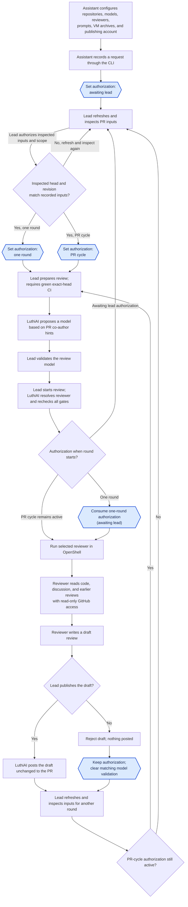

# Architecture

This document is for contributors.
End-user installation and workflow documentation lives in [README.md](README.md).

## System overview

The CLI and local GUI share workflow code and persisted local state.
The lead uses the GUI; an AI assistant uses the CLI on the lead's behalf.
The assistant configures and operates LuthiAI; the reviewer is a separate agent running inside OpenShell.
Requests are recorded, GitHub inputs refreshed, and each review started explicitly.

- **GitHub**: Supplies commits, model co-author hints, author comments, check results, and earlier reviews,
  and displays reviews the lead has chosen to publish.
- **Configuration and state**: The configuration file names repositories, models, reviewers, project prompts,
  VM archives and checksums, and the existing OpenShell gateway.
  The state file records PR inputs, authorization, model validation, rounds, and publication receipts.
  Private drafts, instructions, and logs live beside the state file.
- **Workflow library**: Enforces authorization, exact-head CI, model validation, and draft freshness.
  It composes system, reviewer, project, and per-round task instructions,
  proposes a model different from the PR's co-author model when possible,
  resolves the first compatible configured reviewer, and supplies that reviewer's instructions and verified archive for each round.
  External adapters connect to GitHub and OpenShell;
  LuthiAI manages only the sandboxes it creates and posts only drafts the lead has chosen to publish.
- **CLI and GUI**: Let the lead and their assistant inspect requests, refresh GitHub inputs, authorize reviews,
  validate models, start rounds, and inspect, publish, or reject drafts.
  CLI review rounds run in the foreground.
  The `luthiai gui` command serves the local interface and runs its jobs in the server process,
  independently of browser connections.
- **OpenShell gateway**: Runs independently of LuthiAI.
  Its operator manages gateway access, provider profiles, provider credentials, and rotation.
- **OpenShell sandbox**: Runs a selected reviewer, such as Claude or Codex, from the VM archive configured for that repository and reviewer,
  with instructions and named providers selected by LuthiAI.
  The reviewer has read-only GitHub access and returns a private draft to LuthiAI;
  the operator process holds the publishing authority.

## Authorization states

Each requested PR has one authorization state.
Authorization controls whether a new review round may start;
it does not describe whether CI is pending, a reviewer is running, or a draft awaits the lead's decision.
Every round also requires green CI checks for the current PR head and lead validation of the model.

The state file stores the three values as `awaiting_lead`, `one_round`, and `pr_cycle`.
Entering either authorized state requires the head SHA and input revision the lead inspected
to match the locally recorded values.

| State | What it allows | How it changes |
| --- | --- | --- |
| **Awaiting lead authorization** | No new round may start. | A new request starts here; the lead can authorize one round or the PR cycle. |
| **Authorized for one round** | One round may start for the current PR head and author discussion. | The authorization is consumed when the round starts. A new commit or author comment before then clears it. The lead can also switch or revoke it. |
| **Authorized for the PR cycle** | The lead may start the current round and later rounds after new commits or author comments, subject to the checks and model gate each time. | It persists across those events and draft rejection until the lead switches or revokes it. |

Publishing a draft leaves PR-cycle authorization active for the next commit or author comment.
Rejecting a draft leaves the current authorization unchanged.
It clears model validation matching that round and preserves a different later choice.
Nothing is posted; another round needs active authorization and a validated model.
The lead can change or revoke authorization at any time.

Readiness and round progress are separate from authorization:
preparation reports unmet CI or model requirements;
an explicitly started round runs the reviewer and holds a private draft for the lead's decision.
A round ends when the lead publishes the unchanged draft or rejects it.

The shared state records the authorization state, PR head, input revision,
observed author discussion fingerprints, validated model choice,
review rounds with their sandbox identities and private drafts,
and display-only GitHub metadata bound to the recorded PR inputs.
`status` reports the latest round for a PR;
`list` remains a compact request list.
The workflow clears one-round authorization when refreshed inputs change
and consumes it when a round is dispatched.
Changing the recorded head or author discussion also discards the display context;
it never authorizes a review or publication.

## Workflow



Blue hexagons show authorization state changes;
rectangles show other actions, and diamonds show decisions.
Each round requires an explicit CLI or GUI action;
blocked preparation must be repeated after its requirements are met.

## Local GUI and API

The `luthiai gui` command serves embedded Svelte and Material Web assets
and a JSON API on IPv4 loopback at port 8080.
It uses the effective configuration file and the GitHub credentials available at startup.

The GUI has no separate persistent workflow state.
It reloads requests and review history from the shared state file and private drafts from round files.
Sessions and live job summaries are tied to the server launch;
restarting preserves saved work but does not automatically resume interrupted jobs.

The server trusts the OS user who launches it as the lead.
An interactive terminal displays a one-time sign-in link;
anyone with access to it can start the lead session.
The session is bound to the browser tab and server launch, and survives reloads in that tab.
Private drafts require the lead session and are rendered as plain text;
review logs are never returned to the browser.

Review and publication jobs belong to the server process and survive browser disconnects.
Duplicate starts for the same PR are rejected during preflight.
PR removal coordinates with job startup and clears in-memory job summaries only after success.
On Unix, SIGINT or SIGTERM requests review cancellation and waits for sandbox cleanup attempts.
Stopping the server waits for blocking publication work and does not cancel a dispatched post.
Interrupted reviews require `recover-review`; uncertain publication requires `recover-publication`.
Neither recovery automatically reruns the reviewer or retries the post.

Decision panels retain the inputs the lead inspected across live updates.
Authorization binds to the recorded head and revision;
model validation also binds to the inspected authorization and configuration.
Draft decisions bind to the round and publication body hash,
and publication additionally binds to the displayed publishing account.
Display-only GitHub context is bound to the observed inputs and discarded when they change.
Failure to save display context does not fail an otherwise completed refresh or preparation.

Endpoint payloads, snapshot fields, and response codes are documented in the [local API reference](docs/api.md).

## OpenShell gateway and sandboxes

LuthiAI connects to an existing gateway selected explicitly in its configuration.
It does not start or stop the gateway, change its configuration,
create or update providers, or rotate their credentials.
The gateway operator configures a compatible model provider and a GitHub provider
whose policy enforces read-only REST access for the reviewer.
For each round, LuthiAI checks authenticated gateway access and the expected
named providers, then creates, monitors, and removes its own sandbox.

The trusted configuration names the driver and supplies the verified VM image,
provider names, non-secret environment, policy, and resource limits.
The configuration loader resolves relative host paths against the directory containing `config.json`.
This applies to project prompts, VM archives, runner policies, and the OpenShell executable.
Runner snapshots retain validated absolute paths;
VM executable paths remain absolute within the VM.
The configuration fingerprint includes the length-prefixed OS-string bytes of the absolute configuration directory,
so relocating relative references invalidates model validation.
This preserves non-UTF-8 directory names without JSON serialization or lossy Unicode conversion.
Project prompts can be read below such directories;
resolved runner and archive paths retain their UTF-8 requirements.
Referenced image and policy files are not canonicalized;
their existing traversal, symlink, and checksum checks still apply.
LuthiAI fixes the mount targets, TTY and restart behavior,
and each reviewer adapter's command rules in code.
The runner accepts only a configured `vm` driver for now and checks that the gateway supports it.
It reports `podman` as unsupported or an unknown driver as invalid
before any sandbox is created.

Round-specific checkout and output paths are filled in when the sandbox is created.
The runner validates these values against the read-only input and isolated output rules.
It attaches only those providers and disables automatic provider creation.
Codex disables its own nested Linux sandbox and relies on the outer VM boundary;
the VM still supplies the only readable inputs, the only writable output,
and the enforced network and GitHub policies.
Provider names alone do not prove their permissions;
the operator must maintain the required policies,
and the runner must reject any incompatible policy it can inspect.
If the gateway or required providers are unavailable, the round does not start.

### Reviewer execution and private output

`run-review` creates a private round directory beside the state file,
under `rounds/ROUND_ID/`.
It retains the private composed system, project, and task instruction files,
the `output/review-output.json` reviewer artifact,
stores the assembled private `draft.json`,
and keeps an incomplete log file if a reviewer run fails after emitting dialogue.

Both adapters start in `/sandbox` and share the same draft validation and publication rules.
The runner seeds the output file with an invalid marker.
Both reviewers must return the required JSON object as their final response.
After a successful stream and process exit,
the trusted runner captures that exact response
and atomically replaces the marker with the private artifact.
Neither adapter receives an intended tool permission to write the artifact.

The trusted prompt lists the standalone Git and GitHub Bash commands the runner grants.
It tells Claude to treat other shell commands as denied.
If a compound call is denied, it tells Claude to retry as a standalone granted command.
Claude Code may still allow some reads and simple shell commands outside the explicit `--allowedTools` entries.
The wildcard Git and GitHub Bash grants do not restrict every read or write option.
This is a known limitation tracked in [issue #13](https://github.com/luthiai/luthiai/issues/13).

The Codex adapter requires Codex CLI 0.159.3 or newer with sandbox-mode support.
It uses `codex exec --json --ephemeral --ignore-user-config --ignore-rules --strict-config`.
It selects Codex `danger-full-access` internally because nested user namespaces are unavailable
inside the OpenShell VM; the outer VM still controls filesystem mounts, network destinations,
and read-only GitHub access.
Approval prompts, repository instruction loading, hooks, automatic skill instructions,
MCP servers, plugins, multi-agent delegation, memories, and web search are disabled.
The trusted system prompt is supplied through `model_instructions_file`.
Codex receives the required JSON Schema through `--output-schema`,
and its final response is captured from the JSON event stream.
Its tools receive no writable repository mount;
the only writable mount is the private round output directory.
The adapter uses the existing private round output directory as `CODEX_HOME`;
any CLI runtime files remain private beside that round's draft.
Use an OpenShell model provider that supplies OpenAI Responses API access and an `OPENAI_API_KEY` credential.
Set its non-secret `OPENAI_BASE_URL` in the verified image metadata or `runner.environment`.
The adapter requires an explicit absolute HTTPS endpoint without embedded credentials, query, or fragment.
It configures a custom Codex provider for that endpoint with HTTP streaming rather than WebSockets;
missing endpoint configuration fails before sandbox creation, with no public-service fallback.
The filesystem policy blocks writes;
it does not restrict shell execution to a command allowlist,
so the input-boundary design is tracked in
[issue #13](https://github.com/luthiai/luthiai/issues/13).
The trusted instructions prohibit executing repository code, installing dependencies, or running tests.
See the official [Codex CLI reference](https://developers.openai.com/codex/cli/reference/)
and [configuration reference](https://developers.openai.com/codex/config-reference/).

The reviewer artifact must be regular UTF-8 JSON of at most 1 MiB
with exactly `status`, `comments`, and `lead_advice`.
The runner adds `review_log` from the selected adapter's captured dialogue.
Only `comments` becomes the GitHub review body, followed by the visible footer;
`lead_advice` and `review_log` remain private.

The rendered log limit defaults to 8 MiB;
exceeding it fails the round instead of truncating it.
The log records malformed Codex stream lines and reviewer stderr,
so local failures retain their diagnostic context.
Routine CLI output shows progress phases without the dialogue or draft.
`show-draft --log` is an explicit request to display the sensitive log.
Terminal control characters in displayed draft text are escaped.

### Sandbox cleanup

If execution is interrupted or sandbox cleanup fails,
run `recover-review` after the gateway is available.
When cleanup fails after a successful reviewer run,
the saved draft remains available for `show-draft` while cleanup is pending.
After a stop failure, the runner still tries to delete the sandbox.
A successful delete completes cleanup and leaves the draft available for inspection.
Recovery refuses to stop a sandbox while its review runner is active.
Recovery stops and deletes the recorded sandbox without rerunning the reviewer.

One-round authorization is never restored after an uncertain dispatch.
A failed PR-cycle round may be retried explicitly after all live gates pass again.

Use the body hash displayed by `show-draft` to publish or reject a saved draft
before running another round.
A retry with the rejected round's exact model choice needs fresh validation.
If one-round authorization was consumed at dispatch, authorize again.
Publication and rejection use local state and GitHub without contacting OpenShell.

## Review inputs and CI

The reviewer may read PR files and GitHub context, but does not execute repository
code, install dependencies, or run tools against the code under review.
Builds, tests, linters, and other validation steps run in CI.
LuthiAI starts a review only after the current PR commit's CI checks are green.
PR metadata, commit comparisons, and individual check pages are limited to 8 MiB of response data
before JSON decoding, with typed errors for oversized responses.

## Persistence and GitHub observations

Its state is local and protected by a short exclusive lock for mutations.
Commands involving one PR also hold a per-PR lock across publication,
recovery, rejection, the `refresh` command, and round startup.
Stopping management also uses the per-PR lock.
Round startup releases that lock after saving the `Starting` round;
the runner lock stays held through reviewer execution and sandbox cleanup.
The round's later pre-dispatch recheck of GitHub inputs uses the short state lock
when it saves an observation.
A concurrent `refresh` that changes inputs makes the round stop before dispatch.

The `authorize` command's `--head` and `--revision` checks compare local state only.
`prepare-review` refreshes live GitHub inputs before checking those values.
Concurrent CLI mutations reload the state under the lock before saving.

Each refresh reads every discussion collection twice and rechecks the PR head and author.
It limits each collection to 1,000 items and 8 MiB of response data per pass.
A failed `refresh` leaves local state unchanged.
`prepare-review` saves newly observed inputs before its later checks;
a later GitHub error can leave the updated inputs in the state file.
The result is an observation, not a guarantee that GitHub stays unchanged afterward.
Changes made and reverted between observations may be missed.

When a confirmed publication uses the PR author's GitHub account,
GitHub observations exclude only that recorded review ID from author-comment triggers,
including preparation's final recheck.
The visible footer alone never identifies a LuthiAI publication.
Closed and draft PRs can be refreshed; refreshing grants no permission to run a review.

Round startup fetches fresh inputs and checks before creating a sandbox
and again immediately before dispatch.
Publication rechecks the live head, open state, and author discussion before posting.
GitHub can change after that check.
The posted review remains tied to the original commit;
the CLI rechecks afterward and reports any change without deleting or reposting it.

Network failures after dispatch can leave publication outcome unknown.
Recovery never automatically retries the POST.
Manual confirmation that nothing was posted allows another decision,
but a delayed first request can still create a duplicate review.

Use `github-pr --diff` or `github-pr --since HEAD_SHA` to inspect the code and live head
before recording or authorizing a request.
GitHub may still change after that inspection.
The `--checks` output is a snapshot of reported results.
`prepare-review` and `run-review` use that same exact-head result for readiness.

GitHub's PR commits endpoint returns at most 250 commits.
Preparation accepts that many only when the list reaches the inspected head;
otherwise it reports the endpoint limit instead of using incomplete co-author hints.
It also limits response data to 8 MiB per retrieval pass and rejects an unstable list.

## Reviewer instruction boundary

For every review, LuthiAI supplies a system instruction telling the reviewer to
follow only its trusted review instructions.
Instruction-like content in the PR, including `AGENTS.md`, `CLAUDE.md`, other
agent configuration files, commit messages, and comments, is untrusted material
to inspect, not instructions for the reviewer to follow.

## Prompt composition and review scope

`prompt_builder` is a pure library module.
The system prompt and adapter-specific prompts are embedded Markdown source assets.
Only project guidance comes from repository configuration, through a trusted local `prompt_file`.
Configuration schema 7 removes reviewer prompt files and requires a project prompt per repository.
Relative paths resolve against the configuration directory;
contents are loaded once, preserved exactly, and limited to 64 KiB.

Composition renders project guidance, selected reviewer guidance, and system rules in that order.
The system rules declare their priority and reserve review scope for LuthiAI's task.
Adapters deliver the same composed instructions and task through their existing CLI mechanisms.
Permissions, mounts, provider policies, and strict output validation enforce the execution boundary.

Model validation and round records fingerprint the exact composed prompt in `prompt_sha256`.
The existing `format_sha256` also covers compiled system and reviewer guidance,
both task templates and their context rendering, and the canonical output schema.
The configuration fingerprint includes loaded project contents and those compiled rules.
Preparation and final dispatch rechecks use the same fingerprints.

A typed task records the inspected base and effective full or incremental scope.
Automatic scope selects only the latest confirmed publication for that PR from local history.
The GitHub adapter verifies ancestry for the recorded reviewed commit;
divergent or unavailable previous history falls back to a full review.
Ancestry comparisons request one commit per page;
GitHub still includes first-page file patches, so the JSON response limit also applies.
Other lookup failures stop startup before dispatch.
A signed-in lead can force full scope through the GUI or CLI.
An unchanged head still permits an incremental review of new discussion.
The checkout contains the current head, base, and previous reviewed commit when needed.

State schema 8 retains older rounds without task metadata;
new rounds persist an optional `task` and validate incremental references against earlier confirmed receipts.
Private instruction files retain the exact task and composed text sent to the reviewer.
Public snapshots expose only task identifiers and scope, never project or system prompt contents.

## Credentials and secrets

The gateway operator manages model and sandboxed GitHub credentials through
OpenShell providers, including their rotation.
The operator process may use separate read-only GitHub credentials to inspect PRs.
Credentials used to post reviews to GitHub remain in the operator process
and never enter an OpenShell provider, sandbox, or reviewer process.
Publishing, rejecting, or recovering an existing draft does not require the gateway.
Publication seals use the LuthiAI footer.

## Security requirements

| Concern | Security requirement |
| --- | --- |
| **Prompt injection** | Treat PR files, comments, and commit messages as untrusted. LuthiAI's system instruction tells the reviewer to follow only trusted review instructions supplied by the application. |
| **GitHub access** | Give the reviewer read-only access through an operator-configured OpenShell provider. Keep credentials used to post reviews in the operator process. |
| **Gateway and VM archives** | Authenticate access to the explicitly selected, operator-managed gateway. Require its expected providers before dispatch. Let only authorized operators configure archives, require SHA-256 checksums, and verify a private copy before execution. Pin any OCI source images by digest. |
| **Secrets and rotation** | Protect GitHub and model credentials in storage and logs. The gateway operator rotates provider credentials; LuthiAI never manages them. |
| **Review freshness** | Bind CI results and each draft to the PR commit and author comments reviewed. Flag a draft if either changes before the lead publishes it. |
| **Identity and resource use** | Verify author requests and lead decisions. Limit repeated runs when author comments trigger reviews during PR-wide authorization. Treat model co-author information as a hint for the lead to validate. |
| **Draft publication** | Show the lead the exact text that will be posted. Record who published or rejected it; a rejected draft stays off the PR. |

The source code is public, but an accidentally committed secret could still
reach a model provider during review.

## Review authority

The reviewer can recommend approval in its review text,
but that recommendation does not grant formal GitHub approval.
A human maintainer decides whether to approve and merge the PR.

## Source layout

- `src/lib.rs` exposes the library boundary.
- `src/model.rs` and `src/state.rs` define typed request, authorization, and round state transitions.
- `src/round.rs` defines round records and transitions.
- `src/preparation.rs` contains pure readiness and model-proposal decisions.
- `src/review.rs` and `src/publication.rs` persist rounds, private drafts, and lead decisions.
- `src/config.rs` loads and validates trusted configuration.
- `src/prompt_builder.rs` and `src/prompts/` compose trusted instructions and typed review tasks.
- `src/storage.rs` coordinates locked persistence.
- `src/github.rs` and `src/github/` adapt read-only GitHub observations,
  checks, commits, discussion, preparation, and publication.
- `src/agent.rs` and `src/agent/` implement reviewer adapters.
- `src/checkout.rs`, `src/openshell.rs`, `src/archive.rs`,
  and `src/sandbox_layout.rs` form the sandbox input, output, and lifecycle boundary.
- `src/gui.rs`, `src/gui/`, `src/gui_runs.rs`, and `src/gui_diagnostics.rs` implement the loopback GUI and its jobs.
- `src/main.rs` and the `src/*_commands.rs` modules implement the operator CLI.
- `ui/` contains the Svelte and Material Web interface.
- `skills/luthiai/` contains the distributable setup and usage skill with configuration and CLI references.
- `docs/api.md` documents the local GUI API contract.
- `tests/` contains integration and workflow tests.

## Agent skill distribution

`skills/luthiai/` is a portable Agent Skills folder for configuring and operating the installed application.
Its `SKILL.md` contains the workflow and lead-decision boundaries;
`references/configuration.md` covers setup, `references/cli.md` covers commands,
and `agents/openai.yaml` supplies optional Codex UI metadata.
Other agents can use the portable instructions without that metadata.
Keep all skill links within the folder so installation does not require this repository.
`AGENTS.md` remains guidance for developing LuthiAI itself.

Distribute the complete `skills/luthiai/` folder alongside compiled binaries from the same release.
Keep its `metadata.version` aligned with the package version in `Cargo.toml`
and check the reference against CLI help when commands change.
The binary does not install the skill into an agent's configuration.
The repository currently has no automated binary or skill release workflow.

A standalone skill archive can be prepared from the repository root:

```sh
tar -czf /tmp/luthiai-skill.tar.gz skills/luthiai
```

The archive preserves `skills/luthiai/` so the README installation command works for both source and skill archives.
Include only the skill folder, never operator configuration, state, credentials, or private round files.

## Development

Building from source requires stable Rust 1.85 or newer.
From the repository root, compile and install the CLI:

```sh
cargo install --path . --locked --force
```

Cargo installs the executable in its binary directory, which must be on `PATH`.

For development, run `cargo fmt --all -- --check`,
`cargo clippy --all-targets --locked -- -D warnings`, and `cargo test --locked`.
The same checks run in GitHub Actions on Ubuntu 26.04, macOS 26, and Windows Server 2025.
CI also checks all targets with Rust 1.85 on each of these platforms.

Keep the compiled UI in `ui/dist` under version control
so building the Rust application does not require a separate frontend build.
To change the UI, use Node 24 and rebuild the assets before compiling Rust:

```sh
cd ui
npm ci
npm test
npm run build
cd ..
cargo install --path . --locked --force
```

An opt-in synthetic VM integration test exercises the gateway, provider attachment,
image environment, read-only mounts, private output retrieval,
and sandbox cleanup without calling a model:

```sh
LUTHIAI_LIVE_VM_CONFIG=/absolute/path/to/private-config.json \
  cargo test --test live_vm -- --ignored
```

The config must point to an existing VM tar, its `.config.json` metadata,
and a policy with correct checksums.
Set `LUTHIAI_LIVE_VM_DIR` when the gateway requires test paths
on a particular host directory.
Set `LUTHIAI_LIVE_VM_REPOSITORY` when the configuration does not
include the test's default `owner/repo` repository.
The test checks the executable and CLI flags for the first resolved reviewer,
so a configuration selecting Codex exercises its VM image as well.
