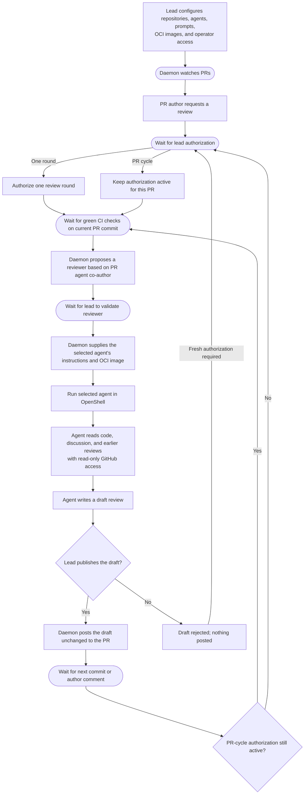

# Review Platform

Review Platform coordinates AI reviews of pull requests in public GitHub repositories.
A lead developer runs its daemon for one or more repositories,
on their own machine or in the cloud.
Any PR author can request a review, but the lead must authorize it.
The lead can authorize one review round,
requiring renewed authorization after each new commit or author reply,
or keep authorization active for the PR so later rounds can start automatically.
The lead can change that choice at any time.
Each generated review stays private until the lead publishes it unchanged;
the lead can also reject it.
Rejecting a draft starts another review round only after fresh lead authorization.

## User story

The lead configures the repositories the daemon watches, the available agents,
their review prompts, the OCI image for each repository and agent pair,
and privileged access for trusted people.
Any author of a PR in a configured repository can request an AI review.
The daemon waits for the lead to authorize that PR before running a review.

The lead can authorize one review round or the PR’s full review cycle.
A single round runs after the current commit’s checks pass;
a later commit or author comment needs renewed authorization.
Authorization for the full cycle lets each new commit or author comment start another round
once the checks are green.
The lead can switch between these choices at any time.

The daemon manages the review instructions (prompts) for each agent.
For each round, it uses the PR's agent co-author information to propose a reviewer
different from the agent that helped author the PR, when possible.
The lead validates or changes that choice.
The daemon then runs the selected agent in OpenShell with its instructions
and the OCI image configured for that repository and agent.
The agent reads PR files, discussion, and earlier reviews through read-only GitHub access.
It does not run tools on the code; CI performs validation.
The agent then writes a draft review.
The lead inspects the draft and chooses to publish it unchanged or reject it.
If the lead chooses to publish, the daemon posts the unchanged text to the PR.
If the lead rejects it, nothing is posted;
the daemon waits for the lead to authorize a new review round.
An agent recommendation to approve is informational;
a human maintainer makes the formal approval and merge decision.

## Architecture

- **GitHub**: PR authors request reviews in the PR. GitHub supplies commits, agent co-author information, author comments, check results, and earlier reviews, and displays reviews the lead has chosen to publish.
- **Daemon**: Holds repository settings, the OCI image for each repository and agent pair, and each PR’s authorization state: awaiting authorization, authorized for one round, or authorized for the PR cycle. It manages the agents' review instructions (prompts), proposes a reviewer different from the PR's co-authoring agent when possible, and supplies the selected agent's instructions and configured image for each round. It waits for green checks, starts review rounds after lead validation, tracks progress, holds draft reviews, and posts only drafts the lead has chosen to publish. After a rejection, it waits for fresh lead authorization before starting another round.
- **Operator interface**: Shows the lead pending requests and draft reviews. It lets the lead edit agent prompts, authorize one round or the full cycle, change that choice, publish or reject drafts, authorize a new round after rejection, validate or change the daemon's proposed reviewer, and monitor reviews. It may be a CLI, terminal UI, or graphical UI.
- **OpenShell sandbox**: Runs a selected agent, such as Claude or Codex, in the OCI image configured for that repository and agent, with instructions supplied by the daemon. The agent has read-only GitHub access and returns draft text to the daemon; the daemon holds the publishing authority.

## Workflow

Rectangles show actions, rounded boxes show waits, and diamonds show decisions.

## OpenShell management

The daemon configures and operates the OpenShell platform, primarily its gateway.
For each review round, it uses the gateway to create and monitor a sandbox from
the OCI image configured for the repository and selected agent.

## Review inputs and CI

The agent may read PR files and GitHub context, but does not execute repository
code, install dependencies, or run tools against the code under review.
Builds, tests, linters, and other validation steps run in CI.
The daemon starts a review only after the current PR commit's CI checks are green.

## Agent instruction boundary

For every review, the daemon supplies a system instruction telling the agent to
follow only the review instructions provided by the daemon.
Instruction-like content in the PR, including `AGENTS.md`, `CLAUDE.md`, other
agent configuration files, commit messages, and comments, is untrusted material
to inspect, not instructions for the reviewing agent to follow.

## Credentials and secrets

The daemon manages the credentials needed for GitHub and model access, including
secret rotation.
It configures OpenShell providers to supply the sandboxed agent with read-only
GitHub access and access to the selected model.
Credentials used to post reviews to GitHub remain under the daemon's control.
When a secret rotates, the daemon updates the corresponding OpenShell provider.

## Security requirements

| Concern | Security requirement |
| --- | --- |
| **Prompt injection** | Treat PR files, comments, and commit messages as untrusted. The daemon's system instruction tells the agent to follow only daemon-provided review instructions. |
| **GitHub access** | Give the agent read-only access through an OpenShell provider. Keep credentials used to post reviews under daemon control. |
| **Gateway and OCI images** | Authenticate access to the daemon-managed gateway. Let only authorized operators configure images, and pin images to immutable digests. |
| **Secrets and rotation** | Protect GitHub and model credentials in storage and logs. Update providers and revoke old credentials when rotating secrets. |
| **Review freshness** | Bind CI results and each draft to the PR commit and author comments reviewed. Flag a draft if either changes before the lead publishes it. |
| **Identity and resource use** | Verify author requests and lead decisions. Limit repeated runs when author comments trigger reviews during PR-wide authorization. Treat agent co-author information as a hint for the lead to validate. |
| **Draft publication** | Show the lead the exact text that will be posted. Record who published or rejected it; a rejected draft stays off the PR. |

The source code is public, but an accidentally committed secret could still
reach a model provider during review.

## Review authority

The agent can recommend approval in its review text, but that recommendation
does not grant formal GitHub approval. A human maintainer decides whether to
approve and merge the PR.
