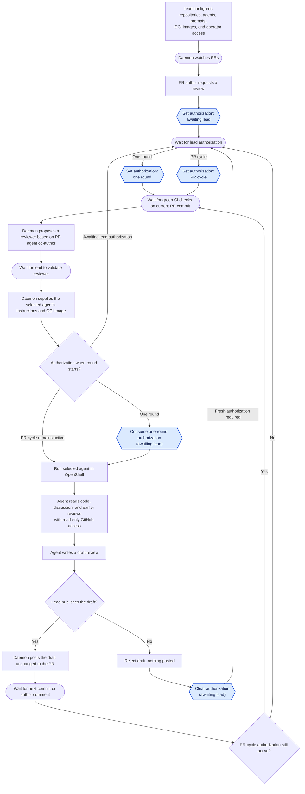

# Review Platform

Review Platform coordinates AI reviews of pull requests in public GitHub repositories.
A lead developer runs its daemon for one or more repositories,
on their own machine or in the cloud.
Any PR author can request a review, but the lead must authorize it.
The lead can authorize one review round,
requiring renewed authorization after each new commit or author reply,
or keep authorization active for the PR so later rounds can start automatically.
The lead can change that choice at any time.
Each generated review stays private until the lead publishes it unchanged;
the lead can also reject it.
Rejecting a draft starts another review round only after fresh lead authorization.

## Run the Rust prototype

The first runnable slice is a local operator CLI for manually recording PR review requests and lead authorization.
It requires stable Rust 1.85 or newer.
From the repository root:

```sh
cargo run -- --help
cargo run -- request owner/repo 42 0123456789abcdef0123456789abcdef01234567
cargo run -- authorize owner/repo 42 --scope one-round
cargo run -- status owner/repo 42
cargo run -- list
cargo run -- state-path
cargo run -- revoke owner/repo 42
cargo run -- help authorize
```

### CLI commands

Run each command as `cargo run -- COMMAND` from the repository root.
`REPOSITORY` means `owner/repo`, `PR` is a positive pull request number,
and `HEAD_SHA` is a 40- or 64-character hexadecimal commit ID.

- `request REPOSITORY PR HEAD_SHA` manually records a review request and its current PR head.
  A new request starts in `awaiting lead authorization`.
  Repeating the same head changes nothing.
  Recording a different head clears `one-round` authorization but preserves `pr-cycle` authorization.
- `authorize REPOSITORY PR --scope one-round` authorizes one review round for an existing request.
  Use `--scope pr-cycle` instead to keep authorization active when the head changes.
  Running `authorize` again can switch between the two scopes.
  It reports an error if the request does not exist.
  This command records the decision; it does not start or consume a review round.
- `revoke REPOSITORY PR` returns an existing request to `awaiting lead authorization` without changing its head.
  It reports an error if the request does not exist.
- `status REPOSITORY PR` prints the recorded head SHA and authorization for one request.
  It reports an error if the request does not exist.
- `list` prints every recorded request, head SHA, and authorization, sorted by repository and PR number.
  It reports that there are no requests when none have been recorded.
- `state-path` prints the absolute path of the effective state file.
  It honors `--state-file` and does not read or create the file.
- `help` prints the command summary; `help COMMAND` prints help for one command.
  `--help` and `--version` are also available.

The global `--state-file PATH` option overrides the default local JSON state file.
Relative override paths are resolved from the current directory.
Without it, the CLI uses the per-user location for each platform:

| Platform | Default state file |
| --- | --- |
| Linux | `$XDG_STATE_HOME/review-platform/state.json` |
| macOS | `~/Library/Application Support/review-platform/state.json` |
| Windows | `%LOCALAPPDATA%\review-platform\data\state.json` |

On Linux, an unset or relative `XDG_STATE_HOME` uses `~/.local/state` instead.
The CLI creates the application directory when it first saves state.
To keep using the previous project-relative file,
pass `--state-file .review-platform/state.json`.
Keep the state file private to the lead operator.

This prototype does not read GitHub, verify requests or CI, start OpenShell,
consume an authorized round, or publish reviews.
It does not track author comments.
CLI input is entered manually by the lead.
Its state is local and intended for one operator process at a time.

For development, run `cargo fmt --all -- --check`,
`cargo clippy --all-targets --locked -- -D warnings`, and `cargo test --locked`.
The same checks run in GitHub Actions on Ubuntu 26.04, macOS 26, and Windows Server 2025.

## User story

The lead configures the repositories the daemon watches, the available agents,
their review prompts, the OCI image for each repository and agent pair,
and privileged access for trusted people.
Any author of a PR in a configured repository can request an AI review.
The daemon waits for the lead to authorize that PR before running a review.

The lead can authorize one review round or the PR’s full review cycle.
A single round runs after the current commit’s checks pass;
a later commit or author comment needs renewed authorization.
Authorization for the full cycle lets each new commit or author comment start another round
once the checks are green.
The lead can switch between these choices at any time.

The daemon manages the review instructions (prompts) for each agent.
For each round, it uses the PR's agent co-author information to propose a reviewer
different from the agent that helped author the PR, when possible.
The lead validates or changes that choice.
The daemon then runs the selected agent in OpenShell with its instructions
and the OCI image configured for that repository and agent.
The agent reads PR files, discussion, and earlier reviews through read-only GitHub access.
It does not run tools on the code; CI performs validation.
The agent then writes a draft review.
The lead inspects the draft and chooses to publish it unchanged or reject it.
If the lead chooses to publish, the daemon posts the unchanged text to the PR.
If the lead rejects it, nothing is posted;
the daemon waits for the lead to authorize a new review round.
An agent recommendation to approve is informational;
a human maintainer makes the formal approval and merge decision.

## Architecture

- **GitHub**: PR authors request reviews in the PR.
  GitHub supplies commits, agent co-author information, author comments, check results, and earlier reviews,
  and displays reviews the lead has chosen to publish.
- **Daemon**: Holds repository settings, the OCI image for each repository and agent pair,
  and each PR’s authorization state: awaiting authorization, authorized for one round, or authorized for the PR cycle.
  It manages the agents' review instructions (prompts), proposes a reviewer different from the PR's co-authoring agent when possible,
  and supplies the selected agent's instructions and configured image for each round.
  It waits for green checks, starts review rounds after lead validation, tracks progress, holds draft reviews,
  and posts only drafts the lead has chosen to publish.
  After a rejection, it waits for fresh lead authorization before starting another round.
- **Operator interface**: Shows the lead pending requests and draft reviews.
  It lets the lead edit agent prompts, authorize one round or the full cycle, change that choice,
  publish or reject drafts, authorize a new round after rejection,
  validate or change the daemon's proposed reviewer, and monitor reviews.
  It may be a CLI, terminal UI, or graphical UI.
- **OpenShell sandbox**: Runs a selected agent, such as Claude or Codex, in the OCI image configured for that repository and agent,
  with instructions supplied by the daemon.
  The agent has read-only GitHub access and returns draft text to the daemon;
  the daemon holds the publishing authority.

## Authorization states

Each requested PR has one authorization state.
Authorization controls whether a new review round may start;
it does not describe whether CI is pending, an agent is running, or a draft awaits the lead's decision.
Every round also requires green CI checks for the current PR head and lead validation of the reviewer.
The state file stores the three values as `awaiting_lead`, `one_round`, and `pr_cycle`.

| State | What it allows | How it changes |
| --- | --- | --- |
| **Awaiting lead authorization** | No new round may start. | A new request starts here; the lead can authorize one round or the PR cycle. |
| **Authorized for one round** | One round may start for the current PR head and author discussion. | The authorization is consumed when the round starts. A new commit or author comment before then clears it. The lead can also switch or revoke it. |
| **Authorized for the PR cycle** | The current round and later rounds triggered by new commits or author comments may start, subject to the checks and reviewer gate each time. | It persists across those events until the lead switches or revokes it, or rejects a draft. |

Publishing a draft leaves PR-cycle authorization active for the next commit or author comment.
Rejecting a draft always returns the PR to awaiting lead authorization;
nothing is posted and another round needs a fresh lead decision.
The lead can change or revoke authorization at any time.

Round progress is separate: waiting for current-head CI, waiting for reviewer validation,
running the agent, and holding a private draft for the lead's decision.
A round ends when the lead publishes the unchanged draft or rejects it.

The current CLI records the authorization state and PR head only.
Its `status` and `list` commands do not report round progress.
It clears one-round authorization on a recorded head change,
but it does not yet observe author comments or start rounds that consume authorization.

## Workflow



Blue hexagons show authorization state changes;
rectangles show other actions, rounded boxes show waits, and diamonds show decisions.

## OpenShell management

The daemon configures and operates the OpenShell platform, primarily its gateway.
For each review round, it uses the gateway to create and monitor a sandbox from
the OCI image configured for the repository and selected agent.

## Review inputs and CI

The agent may read PR files and GitHub context, but does not execute repository
code, install dependencies, or run tools against the code under review.
Builds, tests, linters, and other validation steps run in CI.
The daemon starts a review only after the current PR commit's CI checks are green.

## Agent instruction boundary

For every review, the daemon supplies a system instruction telling the agent to
follow only the review instructions provided by the daemon.
Instruction-like content in the PR, including `AGENTS.md`, `CLAUDE.md`, other
agent configuration files, commit messages, and comments, is untrusted material
to inspect, not instructions for the reviewing agent to follow.

## Credentials and secrets

The daemon manages the credentials needed for GitHub and model access, including
secret rotation.
It configures OpenShell providers to supply the sandboxed agent with read-only
GitHub access and access to the selected model.
Credentials used to post reviews to GitHub remain under the daemon's control.
When a secret rotates, the daemon updates the corresponding OpenShell provider.

## Security requirements

| Concern | Security requirement |
| --- | --- |
| **Prompt injection** | Treat PR files, comments, and commit messages as untrusted. The daemon's system instruction tells the agent to follow only daemon-provided review instructions. |
| **GitHub access** | Give the agent read-only access through an OpenShell provider. Keep credentials used to post reviews under daemon control. |
| **Gateway and OCI images** | Authenticate access to the daemon-managed gateway. Let only authorized operators configure images, and pin images to immutable digests. |
| **Secrets and rotation** | Protect GitHub and model credentials in storage and logs. Update providers and revoke old credentials when rotating secrets. |
| **Review freshness** | Bind CI results and each draft to the PR commit and author comments reviewed. Flag a draft if either changes before the lead publishes it. |
| **Identity and resource use** | Verify author requests and lead decisions. Limit repeated runs when author comments trigger reviews during PR-wide authorization. Treat agent co-author information as a hint for the lead to validate. |
| **Draft publication** | Show the lead the exact text that will be posted. Record who published or rejected it; a rejected draft stays off the PR. |

The source code is public, but an accidentally committed secret could still
reach a model provider during review.

## Review authority

The agent can recommend approval in its review text,
but that recommendation does not grant formal GitHub approval.
A human maintainer decides whether to approve and merge the PR.
